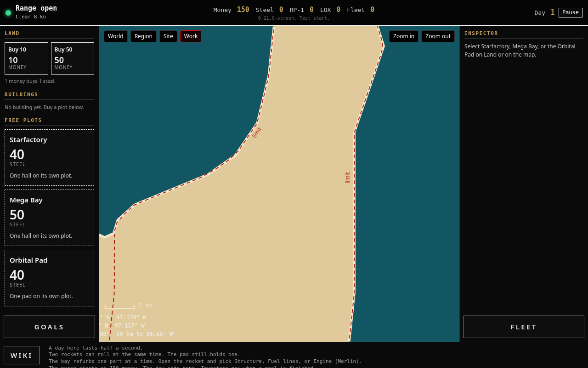

# starbase-builder

A browser game where you run SpaceX hardware for real. You develop Starship at Starbase in Texas, fly it to orbit, then choose where the story goes next.

## Play it

Open `index.html` in a browser. There is no build step. Open `index.html?test` for the same start with fast days. That start is not saved.

## How to play

Buy steel and plots on Land. Build a hopper at Starfactory. Roll it to Mid Bay, then roll it to the Orbital Pad. Run a cryo proof, a tanking run, and a static fire. A hopper starts at Hop 25 m. After that landing, 50 m and 150 m open. A soft 150 m landing opens the tank rocket. That rocket hops 150 m only. A hop rolls back for a 1 day inspection. Parts wear out: Structure, Fuel lines, and Engine (Raptor). Goals, Wiki, and Fleet sit on the screen. The Wiki reads the live numbers, and a note says In real life when the game and the sources differ.

## What's real

The sites, the engines, and the propellants follow real SpaceX hardware. The game simplifies some steps so a session stays short. Those shortcuts sit in the Wiki under In real life notes.

## Status

Live release: `0.20.0-tank`. Next play row: `0.21.0-nose`. The hall you already bought is Mid Bay. The rename spends nothing. High Bay and Mega Bay stay off the map. A hopper hops 25 m until one has landed, then 50 m and 150 m. The tank rocket hops 150 m only. A stored Starhopper keeps its name. The day holds during the fill and the whole hop. The review pays 12 money for each clean test every 30 days. The first soft landing pays Land a hop, 60, and Land a 25 m hop, 20, together. Land a 50 m hop pays 40. Land a 150 m hop pays 60. Land a tank hop pays 80. The header Fires number matches the pad row for the last 30 days. The screen uses four type sizes, and the rocket window is one parts table. The road and the lift run in game days, the speeds are 1x and 3x, and a new build is named SN and a number. Starfactory shows the next hopper and, after a hopper lands 150 m, the next tank rocket. Each card shows thrust, fuel lines, and the Structure floor. A clean hop is the only thing that moves that card. The hop leaves the fuel lines on the rocket that flew. A scrapped serial stays taken. A bay fix repairs the rocket in the bay. Check Structure in Mid Bay costs 1 day and no money. The first reading is about 30 wide. The second is about 10 wide. The cryo proof writes the real Structure. A failed cryo on the hopper sends it back to Mid Bay. A failed cryo on the tank rocket scraps that rocket. The cryo proof, the tanking run, and the static fire stay on the pad.

## Where it's headed

The full build map is [`design-docs/program-roadmap-design.html`](design-docs/program-roadmap-design.html).

1. **Phase 0 · Starbase.** Starship development in Texas up to orbit: Raptor and methane, prototype tests, defects, the rocket window, a bay check, a Structure number you measure, the hopper, the tank hop, the 10 km nose article, a ship and a booster, the stack, a suborbital test, then orbit.
2. **Phase 1 · Recovery and catch.** Bring the booster home, catch it with the tower, inspect and refurbish it, then raise the factory rate.
3. **A branch, in any order.** Starlink. The Moon and Mars, with a depot in orbit. Or the Falcon story at the real Falcon sites: California factory, Kwajalein, Cape Canaveral, Vandenberg, and 39A.
4. **Later chapters.** Compute, the yard, longer flights, picture and record, and a fleet desk.

## How it's built

One person, Tiago, ships the game. A small team of Grok Bot agents helps: Lead, Builder, Critic, Playtester, and Research. The game is one HTML file. Versions are named `N.x.y-codename`. Tiago tests in the browser and is the only one who commits, pushes, and merges.

## Repo map

- [`VERSION`](VERSION) holds the live release label.
- [`AGENTS.md`](AGENTS.md) covers the voice, the realism rules, and how we ship.
- [`FUTURE_FEATURES.md`](FUTURE_FEATURES.md) lists the open ideas.
- [`IMPLEMENTATION_LOG.md`](IMPLEMENTATION_LOG.md) records what already shipped.
- [`design-docs/program-roadmap-design.html`](design-docs/program-roadmap-design.html) is the version map.
- [`design-docs/learning-guide.html`](design-docs/learning-guide.html) holds the lessons.
- [`archive/`](archive/) keeps frozen snapshots of past releases.
