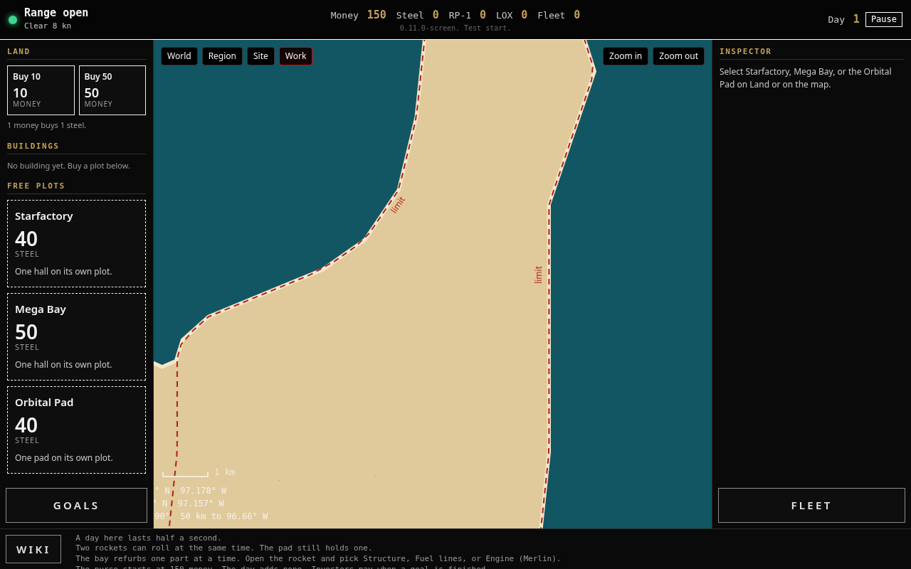

# starbase-builder

A browser game where you run SpaceX hardware for real. You develop Starship at Starbase in Texas, fly it to orbit, then choose where the story goes next.

## Play it

Open `index.html` in a browser. There is no build step. Open `index.html?test` for the same start with fast days. That start is not saved.

## How to play

Buy steel and plots on Land. Build a rocket at Starfactory. Roll it to Mega Bay, then roll it to the Orbital Pad. Load RP-1 and LOX, run a static fire, then launch. Parts wear out: Structure, Fuel lines, and Engine (Merlin). Goals, Wiki, and Fleet sit on the screen. The Wiki reads the live numbers, and a note says In real life when the game and the sources differ.

## What's real

The sites, the engines, and the propellants follow real SpaceX hardware. The game simplifies some steps so a session stays short. Those shortcuts sit in the Wiki under In real life notes.

## Status

Live release: `0.11.0-screen`. Next row: `0.12.0-raptor`. Today's rocket is a Falcon 1 stand-in on the Texas coast. From `0.12.0-raptor` it becomes a Starship development article. Merlin becomes Raptor. RP-1 becomes methane. The oxygen tanks stay.

## Where it's headed

The full build map is [`design-docs/program-roadmap-design.html`](design-docs/program-roadmap-design.html).

1. **Phase 0 · Starbase.** Starship development in Texas up to orbit: Raptor and methane, prototype tests, defects, hop, high hop, stack and tower, suborbital test, then orbit.
2. **Phase 1 · Recovery and catch.** Bring the booster home, catch it with the tower, inspect and refurbish it, then raise the factory rate.
3. **A branch, in any order.** Starlink. The Moon and Mars, with a depot in orbit. Or the Falcon story at the real Falcon sites: California factory, Kwajalein, Cape Canaveral, Vandenberg, and 39A.
4. **Later chapters.** Compute, the yard, longer flights, picture and record, and a fleet desk.

## How it's built

One person, Tiago, ships the game. A small team of Grok Bot agents helps: Lead, Builder, Critic, Playtester, and Research. The game is one HTML file. Versions are named `N.x.y-codename`. Tiago tests in the browser and is the only one who commits, pushes, and merges.

## Repo map

- [`VERSION`](VERSION) holds the live release label.
- [`AGENTS.md`](AGENTS.md) covers the voice, the realism rules, and how we ship.
- [`FUTURE_FEATURES.md`](FUTURE_FEATURES.md) lists the open ideas.
- [`IMPLEMENTATION_LOG.md`](IMPLEMENTATION_LOG.md) records what already shipped.
- [`design-docs/program-roadmap-design.html`](design-docs/program-roadmap-design.html) is the version map.
- [`design-docs/learning-guide.html`](design-docs/learning-guide.html) holds the lessons.
- [`archive/`](archive/) keeps frozen snapshots of past releases.
